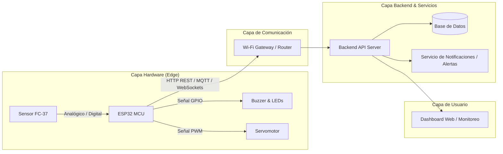

# Rain Detector (Sistema Inteligente de Detección de Lluvia)

Proyecto académico desarrollado para el curso **Paradigmas de Programación** — Universidad Nacional (UNA).

---

## 1. Problemática que Resuelve

Los cambios meteorológicos repentinos, en particular las precipitaciones inesperadas, representan un riesgo significativo en diversos contextos:

- **Hogares y edificios:** Daños en interiores por ventanas o tragaluces abiertos durante tormentas imprevistas.
- **Agricultura e invernaderos:** Exceso de humedad o inundación de cultivos sensibles, así como desperdicio de agua y energía si los sistemas de riego automático continúan activos mientras llueve.
- **Entornos urbanos e industriales:** Falta de telemetría local oportuna para la activación preventiva de drenajes, compuertas o alertas comunitarias.

**Rain Detector** resuelve esta problemática mediante un sistema IoT embebido de monitoreo continuo que detecta la presencia e intensidad de precipitaciones en tiempo real, activa mecanismos de mitigación automáticos (alertas sonoras/visuales y accionamiento de actuadores) y transmite la telemetría a una plataforma centralizada (backend) para su registro, visualización y análisis histórico.

---

## 2. Integrantes del Grupo y Responsabilidades

| Integrante                    | Rol Principal                           | Responsabilidades                                                                                                                                            |
| :---------------------------- | :-------------------------------------- | :----------------------------------------------------------------------------------------------------------------------------------------------------------- |
| **Armando Solís**      | Líder de Desarrollo / Firmware         | Diseño e implementación del firmware en microcontrolador (lectura analógica/digital de sensores, gestión de eventos y estados, transmisión Wi-Fi/MQTT). |
| **[Nombre Apellido 2]** | Desarrollador Backend & Base de Datos   | Arquitectura y desarrollo de la API REST / WebSocket, diseño del modelo de datos, persistencia de eventos y telemetría.                                    |
| **[Nombre Apellido 3]** | Arquitectura & Documentación / Testing | Diseño de diagramas de arquitectura, pruebas de integración hardware-software, evidencias y elaboración de la justificación de paradigmas.               |
| **[Nombre Apellido 4]** | Arquitectura & Documentación / Testing | Diseño de diagramas de arquitectura, pruebas de integración hardware-software, evidencias y elaboración de la justificación de paradigmas.               |

---

## 3. Dispositivos y Componentes Usados

| Componente                                                         | Función en el Proyecto                                          | Justificación de Selección                                                                                                                                                                                                        |
| :----------------------------------------------------------------- | :--------------------------------------------------------------- | :---------------------------------------------------------------------------------------------------------------------------------------------------------------------------------------------------------------------------------- |
| **ESP32 (NodeMCU-32S / WROOM-32)**                           | Unidad central de procesamiento y conectividad (Firmware).       | Incorpora conectividad Wi-Fi (802.11 b/g/n) y Bluetooth BLE nativas, múltiples canales ADC para lecturas analógicas de precisión, soporte para RTOS (gestión concurrente de tareas) y alta eficiencia energética a bajo costo. |
| **Sensor de Lluvia (Módulo FC-37 / YL-83)**                 | Detección de gotas y nivel de humedad superficial.              | Posee una superficie conductora niquelada resistente a la oxidación con comparador LM393 integrado, ofreciendo tanto salida digital (umbral ajustable mediante potenciómetro) como analógica (medición gradual de intensidad).  |
| **Sensor de Temperatura y Humedad (DHT11 / DHT22 o BME280)** | Monitoreo de variables ambientales complementarias.              | Permite correlacionar la humedad relativa y temperatura ambiental con el inicio de lluvias, facilitando análisis predictivos contextuales.                                                                                         |
| **Buzzer Activo y LEDs Indicadores**                         | Señalización local de estado y alarmas de emergencia.          | Respuesta inmediata sin latencia ante detección de lluvia crítica para alerta a usuarios en sitio.                                                                                                                                |
| **Módulo Relé / Servomotor (Opcional)**                    | Mecanismo de mitigación física (cierre de ventana o válvula). | Permite automatizar el aislamiento físico ante lluvia (ej. simulación de compuerta o ventana cerrada).                                                                                                                            |
| **Fuente de Alimentación / Cable Micro-USB**                | Suministro de energía estable (5V / 3.3V).                      | Alimentación constante y confiable para evitar falsos positivos por fluctuaciones de voltaje en el ADC.                                                                                                                            |

---

## 4. Paradigmas de Programación Aplicados

El proyecto fue diseñado integrando múltiples paradigmas de programación, aprovechando las fortalezas de cada uno en los distintos niveles de la solución:

### A. Paradigma Estructurado / Imperativo

- **Dónde se aplica:** En el firmware de bajo nivel ([`src/firmware/`](src/firmware/)).
- **Uso en el código:** Control secuencial de pines GPIO, bucles de muestreo analógico, retardos no bloqueantes basados en temporizadores de hardware (`millis()`) y subrutinas de calibración de sensores.

### B. Paradigma Concurrente / Basado en Eventos

- **Dónde se aplica:** Firmware con FreeRTOS ([`src/firmware/`](src/firmware/)) y Backend asíncrono ([`src/backend/`](src/backend/)).
- **Uso en el código:**
  - **Firmware:** Tareas concurrentes independientes para lectura periódica de sensores, parpadeo de LEDs y publicación de mensajes por Wi-Fi/MQTT sin interrupciones.
  - **Backend:** Manejadores de eventos asíncronos (`async/await` o EventEmitter/WebSockets) para reaccionar inmediatamente a los paquetes de datos entrantes desde el ESP32.

### C. Paradigma Orientado a Objetos (POO)

- **Dónde se aplica:** Modelado de entidades tanto en firmware (controladores modulares de sensores y actuadores) como en el backend ([`src/backend/`](src/backend/)).
- **Uso en el código:** Encapsulación de lógica en clases (`RainSensor`, `NotificationService`, `TelemetryData`), separación de interfaces y abstracción de la capa de persistencia de datos.

### D. Paradigma Funcional

- **Dónde se aplica:** Pipeline de procesamiento de datos en el backend ([`src/backend/`](src/backend/)).
- **Uso en el código:** Uso de funciones puras, inmutabilidad y transformaciones de flujos de datos mediante funciones de orden superior (`map`, `filter`, `reduce`) para el cálculo de promedios móviles, detección de anomalías y filtros de ruido.

> *Para un desglose teórico y justificación profunda, consulta:*
> 🔗 [`docs/justificacion-paradigmas.md`](docs/justificacion-paradigmas.md)

---

## 5. Instrucciones para Ejecutar o Reproducir la Solución

### 5.1. Conexiones Físicas de Hardware (Pinout)

| Componente                     | Pin del Componente | Pin del ESP32                   | Descripción                               |
| :----------------------------- | :----------------- | :------------------------------ | :----------------------------------------- |
| **Módulo Sensor FC-37** | VCC                | 3V3 / 5V                        | Alimentación                              |
|                                | GND                | GND                             | Tierra común                              |
|                                | A0 (Analógico)    | GPIO 34 (ADC1_CH6)              | Lectura analógica de intensidad de lluvia |
|                                | D0 (Digital)       | GPIO 25                         | Detección digital de umbral               |
| **LED Indicador Lluvia** | Ánodo (+)         | GPIO 26 (con resistencia 220Ω) | Encendido al detectar lluvia               |
| **Buzzer**               | VCC / Señal       | GPIO 27                         | Alarma acústica                           |

---

### 5.2. Carga del Firmware (ESP32)

#### Prerrequisitos:

- [Visual Studio Code](https://code.visualstudio.com/) con la extensión [PlatformIO IDE](https://platformio.org/) (recomendado) o [Arduino IDE 2.x](https://www.arduino.cc/en/software).
- Controladores USB a UART (CP2102 o CH340 según la placa).

#### Pasos:

1. Conecta la placa ESP32 a tu computadora mediante un cable USB de datos.
2. Abre la carpeta [`src/firmware/`](src/firmware/) en tu entorno de desarrollo.
3. Configura tus credenciales de red Wi-Fi y servidor en el archivo de configuración (ej. `config.h` o `.env`):
   ```c
   #define WIFI_SSID "TU_RED_WIFI"
   #define WIFI_PASSWORD "TU_CONTRASENA"
   #define BACKEND_URL "http://IP_DE_TU_SERVIDOR:3000/api/telemetry"
   ```
4. Compila y flashea el firmware:
   - **PlatformIO:** Clic en el botón **Upload** (o comando `pio run -t upload`).
   - **Arduino IDE:** Selecciona la placa *ESP32 Dev Module*, el puerto COM correcto y presiona **Subir**.
5. Abre el Monitor Serial a **115200 baudios** para verificar la conexión Wi-Fi y las lecturas del sensor.

---

### 5.3. Levantar el Backend

#### Prerrequisitos:

- [Node.js](https://nodejs.org/) (versión 18+ LTS) o [Python](https://www.python.org/) (3.10+) según la tecnología elegida.
- Gestor de paquetes (`npm` / `pnpm` / `pip`).

#### Pasos:

1. Navega hasta la carpeta del backend:
   ```bash
   cd src/backend
   ```
2. Instala las dependencias del proyecto:
   ```bash
   npm install
   # o si utilizas Python: pip install -r requirements.txt
   ```
3. Configura las variables de entorno creando un archivo `.env`:
   ```env
   PORT=3000
   DATABASE_URL=sqlite://./rain_detector.db
   MQTT_BROKER=mqtt://localhost:1883
   ```
4. Inicia el servidor de desarrollo:
   ```bash
   npm run dev
   # o si utilizas Python: python main.py
   ```
5. El servidor estará escuchando en `http://localhost:3000`.

---

## 6. Enlace al Diagrama de Arquitectura

Para consultar el diagrama detallado de componentes, flujo de comunicación entre firmware, broker/API y base de datos, visita:

👉 **[Documentación y Diagrama de Arquitectura](docs/arquitectura/README.md)**



---

## 7. Bitácoras de Trabajo Individual

Cada integrante cuenta con su bitácora de seguimiento semanal en la carpeta [`bitacoras/`](bitacoras/):

- 📘 [Bitácora - Armando Solís](bitacoras/nombre-apellido-1/bitacora.md)
- 📘 [Bitácora - Integrante 2](bitacoras/nombre-apellido-2/bitacora.md)
- 📘 [Bitácora - Integrante 3](bitacoras/nombre-apellido-3/bitacora.md)

---

## 📁 Estructura General del Repositorio

```text
rain_detector/
├── README.md                           # Información general del proyecto
├── src/
│   ├── firmware/                       # Código fuente ESP32 / microcontrolador
│   └── backend/                        # API, servicios y modelos de datos
├── docs/
│   ├── arquitectura/                   # Diagramas y especificación de arquitectura
│   │   └── README.md
│   ├── pruebas/                        # Evidencias: capturas, fotos, videos y tablas
│   │   └── README.md
│   └── justificacion-paradigmas.md     # Documento de justificación de paradigmas
└── bitacoras/
    ├── nombre-apellido-1/              # Bitácora individual integrante 1
    │   └── bitacora.md
    ├── nombre-apellido-2/              # Bitácora individual integrante 2
    │   └── bitacora.md
    └── nombre-apellido-3/              # Bitácora individual integrante 3
        └── bitacora.md
```
