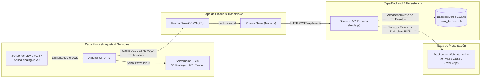

# Rain Detector — Tendedero Automatizado IoT con Detección de Lluvia

Proyecto académico desarrollado para el curso **Paradigmas de Programación** — Universidad Nacional (UNA), Ciclo II 2026.

---

## 1. Problemática que Resuelve

Tender la ropa al aire libre para su secado natural es una práctica cotidiana ampliamente utilizada; sin embargo, los cambios meteorológicos repentinos y las precipitaciones inesperadas representan un inconveniente significativo cuando no hay una persona disponible en el hogar para retirarla a tiempo. Como consecuencia, las prendas terminan mojadas, requiriendo un nuevo ciclo de lavado y secado, lo que genera desperdicio de agua, energía y tiempo.

**Rain Detector** resuelve esta problemática mediante un prototipo IoT de **tendedero automatizado inteligente**:
- **Detección en tiempo real:** Un sensor de lluvia (FC-37) monitorea permanentemente la presencia de agua sobre su superficie.
- **Accionamiento mecánico inmediato:** Al detectar lluvia, un microcontrolador Arduino UNO ordena a un servomotor retraer automáticamente el tendedero hacia una posición protegida bajo techo (0°); al cesar la lluvia y secarse el sensor, el sistema lo extiende nuevamente al exterior (90°).
- **Telemetría y supervisión web:** El sistema transmite el estado y los valores analógicos a una aplicación web con backend en Node.js y base de datos SQLite, permitiendo visualizar en un dashboard el estado ambiental en tiempo real, alertas de activación y el historial cronológico de eventos.

---

## 2. Integrantes del Grupo y Responsabilidades

| Integrante | Rol Principal | Responsabilidades |
| :--- | :--- | :--- |
| **Alessandro Godínez Rodríguez** | Líder de Firmware & Hardware | Programación del firmware en Arduino UNO (`arduino_detector_lluvia.ino`), calibración de umbrales analógicos del sensor FC-37, control del servomotor e identificación de paradigmas de programación en el código. |
| **Carolina Zhou Zheng** | Desarrolladora Web & Backend | Arquitectura del backend con Node.js y Express (`server.js`), modelo de persistencia en SQLite (`database.js`), desarrollo de la interfaz de usuario web (`app.js`, `index.html`, `styles.css`) e integración firmware-web. |
| **Manuel Cárdenas Sánchez** | Arquitectura & Conexiones Físicas | Elaboración y revisión del diagrama de arquitectura global, verificación de conexiones físicas entre microcontroladores, facilitación de componentes y pruebas de integración. |
| **Armando José Solís Villegas** | Configuración, Maqueta & Documentación | Configuración del entorno de desarrollo local y estructura del repositorio, elaboración de elementos a escala (ropa) para la maqueta, investigación bibliográfica y referencias en formato IEEE para el artículo del proyecto. |

---

## 3. Dispositivos y Componentes Usados

| Componente | Función en el Proyecto | Justificación de Selección |
| :--- | :--- | :--- |
| **Arduino UNO R3** | Microcontrolador principal de adquisición y control. | Adquisición analógica estable en pin `A0` mediante su ADC de 10 bits, generación de señales PWM para el servomotor y comunicación serial con la computadora a 9600 baudios. |
| **Sensor de Lluvia (FC-37 / YL-83)** | Detección física de gotas de agua e intensidad. | Placa sensora con pistas niqueladas conductoras que reducen su resistencia en presencia de agua, entregando una señal analógica proporcional a la humedad superficial. |
| **Micro Servomotor SG90** | Actuador mecánico del tendedero. | Movimiento angular preciso entre 0° (ropa protegida / adentro) y 90° (ropa expuesta / afuera) con bajo consumo y facilidad de integración física a la palanca de la maqueta. |
| **Computadora / Enlace Serial USB** | Puente de transmisión entre Arduino y Backend. | Comunicación a través de puerto serial COM3 mediante un script intermediario (`serial-bridge.js`) que envía las lecturas vía HTTP POST (`/api/events`) al backend. |
| **ESP32 (NodeMCU-32S / WROOM-32)** | Plataforma alternativa de conectividad Wi-Fi. | Dispone de firmware (`esp32_panel_wifi.ino`) para comunicación inalámbrica y panel web local, previsto como enlace de red directo para futuras iteraciones del prototipo. |
| **Maqueta de Vivienda con Tendedero** | Estructura física demostrativa. | Representación a escala de una vivienda con zona exterior e interior protegida, equipada con tendedero funcional y prendas en miniatura. |

---

## 4. Paradigmas de Programación Aplicados

La solución fue desarrollada combinando múltiples paradigmas de programación según las responsabilidades de cada componente:

### A. Programación Orientada a Objetos (POO)
- **Dónde se aplica:** En el firmware del Arduino UNO ([`src/firmware/arduino_detector_lluvia.ino`](src/firmware/arduino_detector_lluvia.ino)).
- **Uso en el código:** Abstracción y encapsulamiento de hardware en clases modulares:
  - `SensorLluvia`: encapsula la lectura analógica y la evaluación del umbral de agua.
  - `Tendedero`: gestiona los ángulos del servo (90° afuera, 0° adentro) y el estado físico de la ropa.
  - `EnlaceESP32`: abstrae el protocolo de comunicación serial de texto.
  - `DetectorLluvia`: coordina el flujo general y las transiciones del sistema.

### B. Programación Concurrente y Dirigida por Eventos
- **Dónde se aplica:** En el Backend Node.js ([`src/backend/`](src/backend/)), Frontend ([`src/frontend/`](src/frontend/)) y transiciones de firmware.
- **Uso en el código:**
  - **Firmware:** Reacción inmediata ante eventos de cambio de estado (inicio de lluvia `isRaining: true` y cese `isRaining: false`).
  - **Backend:** Manejo asíncrono no bloqueante de peticiones HTTP en Express para registrar eventos concurrentes de telemetría sin congelar el servidor.
  - **Frontend:** Temporizadores periódicos y event listeners para actualizar métricas en vivo en el navegador.

### C. Programación Imperativa / Estructurada
- **Dónde se aplica:** Subrutinas de lectura de pines analógicos en el microcontrolador y rutinas de inicialización de periféricos y base de datos SQLite.

### D. Programación Funcional
- **Dónde se aplica:** Procesamiento de datos en el backend ([`src/backend/server.js`](src/backend/server.js)), filtros y mapeos para formatear históricos cronológicos y deduplicar estados repetidos.

---

## 5. Instrucciones para Ejecutar o Reproducir la Solución

### 5.1. Conexiones Físicas de Hardware

| Componente | Pin del Componente | Pin en Arduino UNO | Descripción |
| :--- | :--- | :--- | :--- |
| **Sensor de Lluvia FC-37** | VCC | 5V | Alimentación del módulo sensor |
| | GND | GND | Tierra común |
| | A0 (Analógico) | A0 | Entrada analógica (lecturas de 0 a 1023) |
| **Micro Servomotor SG90** | Señal (Naranja/Amarillo) | Pin 9 | Señal PWM de control de ángulo |
| | VCC (Rojo) | 5V | Alimentación del motor |
| | GND (Café/Negro) | GND | Tierra común |
| **Conexión Serial PC** | Puerto USB | Cable USB tipo A-B | Transmisión serial COM a 9600 baudios |

---

### 5.2. Carga del Firmware en Arduino UNO

1. Conecta el Arduino UNO a tu computadora mediante el cable USB.
2. Abre el archivo [`src/firmware/arduino_detector_lluvia.ino`](src/firmware/arduino_detector_lluvia.ino) en **Arduino IDE**.
3. En el menú **Herramientas**:
   - Selecciona la placa: **Arduino Uno**.
   - Selecciona el puerto serie correspondiente (ej. `COM3` en Windows).
4. Haz clic en **Subir** (Upload).
5. Abre el **Monitor Serie** a `9600 baudios` para verificar las lecturas analógicas (umbral de lluvia predeterminado: `300`).

---

### 5.3. Puesta en Marcha del Backend y Frontend

#### Prerrequisitos:
- [Node.js](https://nodejs.org/) (versión 18+ LTS recomendada).
- Gestor de paquetes `npm`.

#### Pasos:
1. Abre una terminal y navega a la carpeta del backend:
   ```bash
   cd src/backend
   ```
2. Instala las dependencias del servidor:
   ```bash
   npm install
   ```
3. Inicia el servidor:
   ```bash
   npm start
   ```
4. El servidor iniciará en el puerto `3000`:
   - **Dashboard Web:** Abre tu navegador en [http://localhost:3000](http://localhost:3000).
   - **API REST disponible:**
     - `GET /api/status`: Estado actual de lluvia y última lectura.
     - `GET /api/events`: Historial cronológico de eventos registrados en SQLite.
     - `POST /api/events`: Endpoint para recibir lecturas del sensor (`{ "isRaining": true, "reading": 386 }`).

---

### 5.4. Puente Serial (Arduino USB ➔ Backend)

Para reenviar las lecturas emitidas por el Arduino por el puerto USB hacia el backend en tiempo real:

1. Asegúrate de cerrar el Monitor Serial del Arduino IDE para liberar el puerto COM.
2. Ejecuta el puente serial en una terminal:
   ```bash
   node serial-bridge.js
   ```
   *(Lee las tramas emitidas por el Arduino en el puerto COM3 y genera solicitudes `POST http://localhost:3000/api/events` recibiendo respuestas HTTP 200).*

---

## 6. Diagrama de Arquitectura Global



---

## 7. Bitácoras de Trabajo Individual

El progreso detallado, las dificultades enfrentadas y las soluciones técnicas de cada integrante se encuentran documentados en:

- 📘 [Bitácora — Alessandro Godínez Rodríguez](bitacoras/Alessandro-Godinez/bitacora.md)
- 📘 [Bitácora — Armando José Solís Villegas](bitacoras/Armando-Solis/bitacora.md)
- 📘 [Bitácora — Carolina Zhou Zheng](bitacoras/Carolina-Zhou/bitacora.md)
- 📘 [Bitácora — Manuel Josué Cárdenas Sánchez](bitacoras/Manuel-Cardenas/bitacora.md)

---

## 📁 Estructura del Repositorio

```text
rain_detector/
├── README.md                           # Descripción general y guía del proyecto
├── bitacoras/                          # Bitácoras individuales de los integrantes
│   ├── Alessandro-Godinez/
│   │   └── bitacora.md
│   ├── Armando-Solis/
│   │   └── bitacora.md
│   ├── Carolina-Zhou/
│   │   └── bitacora.md
│   └── Manuel-Cardenas/
│       └── bitacora.md
├── docs/                               # Documentación técnica y académica
│   ├── arquitectura/
│   │   └── README.md                   # Descripción de capas del sistema
│   ├── pruebas/
│   │   └── README.md                   # Guía y evidencias de pruebas
│   └── justificacion-paradigmas.md     # Fundamentación teórica de paradigmas
└── src/                                # Código fuente de la solución
    ├── firmware/
    │   ├── arduino_detector_lluvia.ino # Firmware Arduino (sensor, servo y POO)
    │   ├── esp32_panel_wifi.ino        # Firmware ESP32 (panel web y conectividad Wi-Fi)
    │   └── README.md
    ├── backend/
    │   ├── database.js                 # Inicialización y consultas SQLite
    │   ├── server.js                   # API REST Express y servidor estático
    │   ├── package.json
    │   └── test/
    │       └── backend.test.js         # Pruebas automatizadas del backend
    └── frontend/
        ├── index.html                  # Estructura del dashboard web
        ├── styles.css                  # Estilos visuales del dashboard
        └── app.js                      # Lógica de consumo de API y actualización
```
